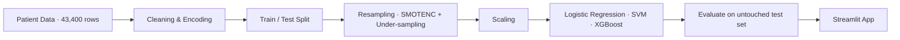

<div align="center">

# 🧠 Cerebral Stroke Prediction

**Predicting stroke risk from patient health data — with a focus on catching the rare positive cases that matter most.**


</div>

---

## 📌 Overview

Stroke is a leading cause of death and disability, and early risk detection can save lives.
The challenge: in the dataset of **43,400 patients**, fewer than **2 %** had a stroke. A model that
always predicts "no stroke" scores 98 % accuracy while missing every patient at risk.

This project therefore optimises for **recall on the stroke class** rather than raw accuracy, and
deploys the final model in a Streamlit app.

## ⚙️ Approach



**Features:** gender · age · hypertension · heart disease · marital status · work type · residence type · average glucose level · BMI · smoking status

**Handling class imbalance**
- **SMOTENC** — synthetic over-sampling that respects categorical features
- **Random under-sampling** to balance the training set
- **Balanced class weights**
- Resampling applied to the **training set only**, so the test set reflects real-world class ratios

## 📊 Results (Test Set · 8,680 patients, 157 strokes)

| Model | Stroke Recall | Accuracy |
|---|---|---|
| **Logistic Regression** | **0.75** | 0.74 |
| SVM | 0.00 | 0.98 |
| XGBoost | 0.00 | 0.98 |

**Logistic Regression was selected for deployment:** it identifies **75 % of stroke patients** in the test set
(118 of 157). The 98 % accuracy of the other models comes from predicting "no stroke" for everyone, which
shows why accuracy is a misleading metric for imbalanced medical data.

## 🧰 Tech Stack

Python · Pandas · NumPy · Scikit-learn · XGBoost · imbalanced-learn · Matplotlib · Joblib · Streamlit

## 📂 Project Structure

```text
├── stroke_prediction.ipynb   # EDA, preprocessing, resampling, training & evaluation
└── app.py                    # Streamlit app for patient risk prediction
```

## 🚀 Getting Started

```bash
git clone https://github.com/Ammarjm/cerebral-stroke-prediction.git
cd cerebral-stroke-prediction
pip install pandas numpy scikit-learn xgboost imbalanced-learn matplotlib joblib streamlit
```

Run the notebook to train the model and save `models/logistic_stroke_model1.joblib`, then launch the app:

```bash
streamlit run app.py
```

## 🔮 Future Improvements

- Threshold tuning to balance recall and precision
- Precision–recall curves and ROC-AUC reporting
- Probability calibration for clinically interpretable risk scores

## 👤 Author :

**Ammar Alsabateen** — AI & Machine Learning Engineer
[GitHub](https://github.com/Ammarjm) · [Email](mailto:alsabateenammar@gmail.com)
